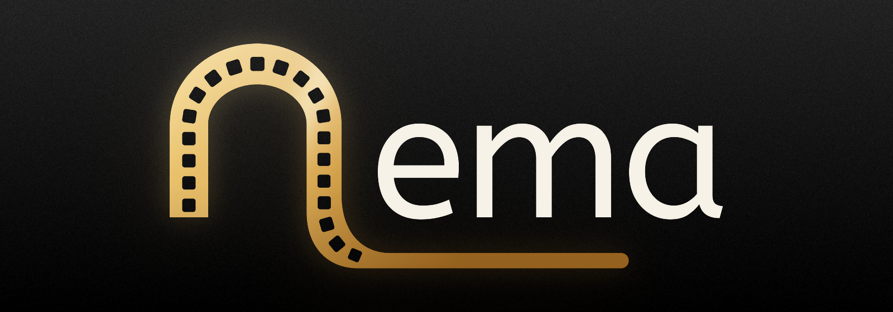

<em>A new Jellyfin thread, spun from Wholphin.</em>

# Nema

Nema is a Jellyfin client for Android TV. It is a fork of [Wholphin](https://github.com/damontecres/Wholphin), the open-source Android TV client by damontecres, tuned for a calmer, more cinematic living-room experience.

The name comes from the nematocyst, the stinging thread of a jellyfish: Greek *nēma* means thread. It nods to the Jellyfin family, to a fork as a thread pulled from something larger, and, said out loud, to the end of *cinema*.

> Nema was previously called WholphinFluid. The repository URL still uses the old name.

## What's different from Wholphin

- **Themes:** four themes (Vivid, Muted, Dark and Darkest) plus a separate highlight colour for focus and accents, with gold as the default
- **Typography:** ABeeZee for the interface and for subtitles
- **Subtitles:** settings to ignore embedded subtitle colours and styling
- **Video adjust:** Kodi-style zoom, pixel ratio and position controls during playback, for ultrawide screens and odd aspect ratios
- **Player:** ExoPlayer only; the MPV option is hidden
- **Backdrops:** a blurred backdrop with colour glows and film grain behind the home screen
- **Installs next to Wholphin:** Nema has its own app ID, so both can be installed on the same box

Work in progress is tracked in the [roadmap](ROADMAP.md).

## Installation

Nema has no store listing yet. Build it from source with the release build type, see the [developer's guide](DEVELOPMENT.md). The release build installs as **Nema** alongside Wholphin; the `fast` build type installs as **Nema Fast** for quick testing on a device.

For Wholphin itself, see the [Wholphin releases](https://github.com/damontecres/Wholphin/releases/latest).

## Compatibility

Requires Android 6+ (or Fire TV OS 6+) and Jellyfin server `10.10.x` or `10.11.x`, as upstream Wholphin.

## Brand

The logo is a strip of film bent into a lowercase n, whose tail runs on as a single thread under the rest of the name. It is set in gold on near-black.

| | |
|---|---|
| Gold gradient | `#F6D98C` → `#DDA94A` → `#A86F22` |
| Lettering | `#F7F2E8` |
| Background | `#222222` → `#000000`, with film grain |
| Typeface | [ABeeZee](https://fonts.google.com/specimen/ABeeZee) |

Logo files, the app icon and posters are in [`branding/`](branding).

## Contributions

Issues and pull requests are welcome. Please read the [contributing guide](CONTRIBUTING.md), which comes from upstream Wholphin and applies here too. Fixes that are not specific to Nema are best sent to [Wholphin](https://github.com/damontecres/Wholphin) first.

## Acknowledgements

- Thanks to damontecres and the Wholphin contributors. Nema is built on their work, and nearly everything good in it starts there
- Thanks to the Jellyfin team for creating and maintaining such a great open-source media server
- Thanks to the official Jellyfin Android TV client developers, some code for creating the device direct play profile is adapted from there
- Thanks to the Jellyfin Kotlin SDK developers for making it easier to interact with the Jellyfin server API
- Thanks to numerous other libraries that make app development even possible

## License

Nema is licensed under the GNU General Public License v2, as Wholphin is. See [LICENSE](LICENSE).
